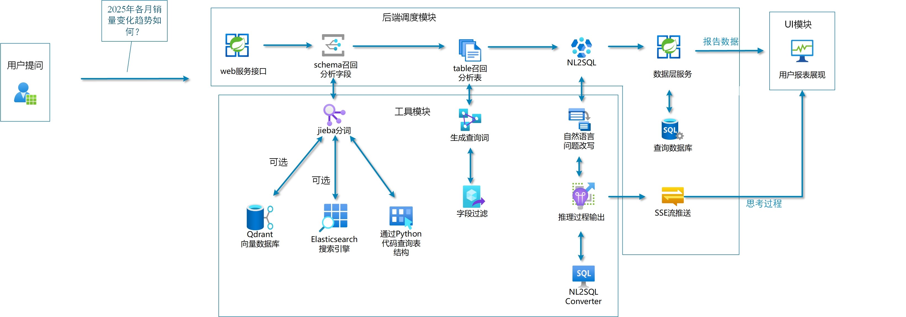
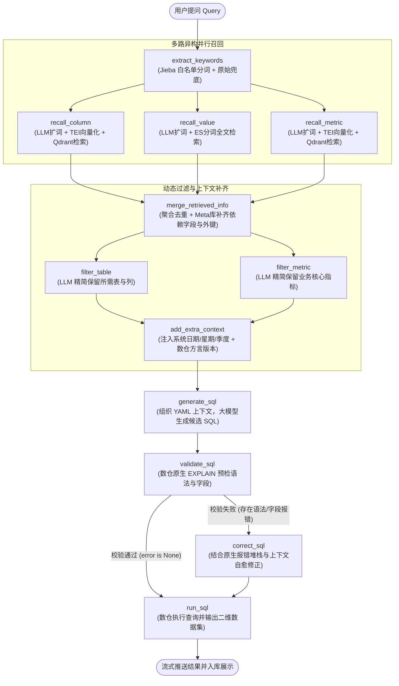

**问数 (DWQ Agent) - 企业级 Text-to-SQL 智能分析系统**

> 面向企业数据分析与数字化运营场景的 **全栈式 NL2SQL / Text-to-SQL 智能体问答系统**。  
> 突破传统“直接将问题与大段 Schema 扔给模型”的脆弱模式，基于 **元数据驱动** 构建 **多路混合检索 + LangGraph 多阶段推理 + 真实数据库校验自愈 + SSE 流式可视化** 的端到端企业级解决方案。




## 目录

- [📖 项目介绍](#-项目介绍)
- [✨ 项目亮点](#-项目亮点)
- [🏗️ 架构设计](#️-架构设计)
  - [1. 总体分层架构](#1-总体分层架构)
  - [2. LangGraph 智能体推理工作流](#2-langgraph-智能体推理工作流)
  - [3. 元数据知识库双链路模型](#3-元数据知识库双链路模型)
- [🛠️ 技术栈](#️-技术栈)
- [📁 项目目录结构](#-项目目录结构)
- [🚀 部署与启动指南](#-部署与启动指南)
  - [1. 环境要求](#1-环境要求)
  - [2. 基础设施一键启动 (Docker Compose)](#2-基础设施一键启动-docker-compose)
  - [3. 构建元数据知识库](#3-构建元数据知识库)
  - [4. 配置与启动后端服务](#4-配置与启动后端服务)
  - [5. 启动前端交互界面](#5-启动前端交互界面)
- [🔮 优化与扩展方向](#-优化与扩展方向)


## 📖 项目介绍

在企业日常运营中，面对数以千计的数据表、繁杂的维度与指标，传统的商业智能（BI）与数据取数往往面临如下痛点：

1. **门槛高**：业务与运营人员不具备编写复杂 SQL 的能力，高度依赖数据分析师，响应周期长。
2. **理解难**：数据分析师在跨业务线取数时，难以快速摸透全部底表结构、外键关联、同义词及计算口径。
3. **大模型直出幻觉严重**：直接让大模型根据问题写 SQL，极易出现**字段选错、指标公式理解偏差、过滤条件值与数据库真实枚举不符、表关联错误（JOIN Missing）**以及语法错误。

**掌柜问数（Shopkeeper Agent）** 围绕解决上述问题而设计，定位为企业的**虚拟数据分析师**：

- **业务口语交互**：用户只需使用日常自然语言提问（如 *“统计华北地区今年各品类的销售总额”*）。
- **多路知识召回**：系统自动完成关键词与意图扩展，从向量知识库中召回相关字段与业务指标，从全文索引中召回真实的维度取值。
- **智能裁剪上下文**：大模型对候选表和指标进行二次精炼，剔除无用字段，规避长上下文噪声并节约 Token。
- **环境感知与生成**：自动补充系统日期信息与数据库方言环境，驱动大模型生成高质量候选 SQL。
- **执行前自愈校验**：借助数仓原生 `EXPLAIN` 语法引擎提前校验，若报错则捕获真实堆栈进行自动纠错修复。
- **端到端流式展现**：通过 Server-Sent Events (SSE) 协议实时推流执行进度，前端即时渲染状态轨、SQL 查看器、数据明细表以及 ECharts 动态分析图表。


## ✨ 项目亮点

- **⚡ 检索 + 推理 + 生成，拒绝“黑盒直出”**  
  不走单次 Prompt 赌概率的路线，而是拆解为细粒度的有向无环工作流。严格按照“检索元数据 -> 过滤候选集 -> 补充上下文 -> 生成候选 SQL -> 数据库解析校验 -> 报错自动修正 -> 执行与渲染”逐步推进，链路高度可控、可观测、可调试。

- **🔍 多路异构混合召回（Hybrid Retrieval）**  
  针对企业问数的三大核心实体分别建立索引与检索策略：
  - **字段召回（Column Recall）**：`Qdrant` 向量数据库，针对字段名、中文描述与业务别名（Alias）建立独立语义向量入口。
  - **指标召回（Metric Recall）**：`Qdrant` 独立集合，将通用业务口径（如 GMV、客单价、转化率）及其依赖字段映射为统一知识点。
  - **维度值召回（Value Recall）**：`Elasticsearch + IK 分词` 全文检索，彻底攻克 *“用户提问中的口语词与数据库底层存储值不一致”* 的顽疾（如用户说“华北地区”，系统自动匹配并对齐存储值 `'华北'`）。
  - **元数据落库（Meta Store）**：`MySQL` 保存权威的表关系、字段属性与外键定义，作为单一事实来源（SSOT）。

- **🎯 上下文动态裁剪与 Token 优化**  
  合并召回结果后，通过 LLM 节点对候选表字段和指标进行精简（Filter），仅保留计算所需的最小子集，极大压缩注入 Prompt 的 Token 体积，显著降低大模型幻觉率并加快推理速度。

- **🛡️ SQL 语法预检与自愈修复（Self-Healing Loop）**  
  在实际执行查询产生开销之前，利用数据仓库引擎的 `EXPLAIN` 能力对生成的 SQL 进行语法和元数据解析。若捕获到报错（如字段不存在、JOIN 语法错误），通过 LangGraph 条件边动态路由至修正节点，结合数据库原生错误日志实现自动化自愈，大幅提升最终执行成功率。

- **🌊 全流程 SSE 流式输出与可视化**  
  基于标准 Server-Sent Events 实现后端到前端的进度通知与数据流转。用户可以清晰观察到“抽取关键词 -> 召回信息 -> 过滤裁剪 -> 生成 SQL -> 校验 SQL -> 执行 SQL”每个节点的实时耗时与状态。

- **📊 前后端一体化开箱即用**  
  后端采用现代化的 `FastAPI + LangGraph + Repository Pattern` 清晰分层；前端配备基于 `Vue 3 + Vite + Tailwind CSS + ECharts` 的极简交互面板，支持在**数据表格**与**交互式柱状图/折线图**间无缝切换。


## 🏗️ 架构设计

### 1. 总体分层架构

系统整体分为 **前端交互层**、**API 服务层**、**智能体编排引擎**、**业务仓储层**、**基础设施与知识库** 以及 **离线知识构建链路**：

```
+-----------------------------------------------------------------------------------+
|                             前端展示层 (Frontend - Vue 3)                         |
|   +-------------------+  +-------------------+  +-------------------------------+  |
|   | 聊天气泡 & 交互框  |  | 状态执行轨(Step)  |  | SQL查看 / 数据表格 / ECharts  |  |
|   +-------------------+  +-------------------+  +-------------------------------+  |
+------------------------------------------▲----------------------------------------+
                                           │ SSE (Server-Sent Events) / HTTP
+------------------------------------------▼----------------------------------------+
|                             API 网关层 (FastAPI Backend)                          |
|   - 全局请求拦截中间件 (ContextVar UUID 追踪)                                       |
|   - Lifespan 资源生命周期管理 (Qdrant, ES, MySQL, TEI 客户端统一管控)             |
|   - /api/query 路由分发与依赖注入 (QueryService)                                  |
+------------------------------------------▲----------------------------------------+
                                           │
+------------------------------------------▼----------------------------------------+
|                       Agent 编排引擎 (LangGraph StateGraph)                       |
|  [分词扩词] ➔ [三路召回] ➔ [信息合并] ➔ [表/指标裁剪] ➔ [环境上下文] ➔ [SQL生成/自愈/执行]|
+------------------------------------------▲----------------------------------------+
                                           │
+------------------------------------------▼----------------------------------------+
|                        仓储与客户端管理层 (Repository Layer)                      |
|   +-------------------------+  +--------------------------+  +------------------+ |
|   | MetaMySQLRepository     |  | ColumnQdrantRepository   |  | ValueESRepository| |
|   | DWMySQLRepository       |  | MetricQdrantRepository   |  | EmbeddingClient  | |
|   +-------------------------+  +--------------------------+  +------------------+ |
+------------------------------------------▲----------------------------------------+
                                           │
+------------------------------------------▼----------------------------------------+
|                              基础设施与数据存储层                                 |
|   +---------------------+  +---------------------+  +---------------------------+ |
|   |   MySQL 8.0 (DW)    |  |  MySQL 8.0 (Meta)   |  |   Qdrant Vector DB        | |
|   |   数仓真实业务数据   |  |  权威表结构/指标依赖 |  |   字段与指标语义稠密向量  | |
|   +---------------------+  +---------------------+  +---------------------------+ |
|   +----------------------------------------------+  +---------------------------+ |
|   |            Elasticsearch 8.19 + IK           |  | HuggingFace TEI (BGE-1.5) | |
|   |            维度真实取值全文检索索引          |  | 高性能本地向量推理服务    | |
|   +----------------------------------------------+  +---------------------------+ |
+-----------------------------------------------------------------------------------+
```


### 2. LangGraph 智能体推理工作流

系统在线查询链路采用 `LangGraph` 编译的有向图进行状态流转，各阶段节点协同执行如下：




### 3. 元数据知识库双链路模型

系统围绕数据资产构建了**知识抽取构建**与**实时分析查询**双循环：

1. **离线/配置构建链路（Build Pipeline）**：
   - 依据业务方填写的 `conf/meta_config.yaml`。
   - 连接数仓（`DW MySQL`）抓取真实字段类型与全量维度取值。
   - 结构化数据存入 `Meta MySQL`（表、字段、指标、指标与字段映射表）。
   - 将字段信息与指标信息的一词多义、别名（Alias）切分多 entry 经由 TEI 向量化存入 `Qdrant`。
   - 对开启 `sync: true` 的维度枚举值，全量抽取并分批批量同步到 `Elasticsearch`（配置 IK 分词器）。
2. **在线查询问答链路（Query Pipeline）**：
   - 自然语言输入后，触发多路召回与 LangGraph 流转。
   - 最终产出安全 SQL 并下推至数仓执行。


## 🛠️ 技术栈

| 分类 | 技术组件 | 说明 |
| :--- | :--- | :--- |
| **编程语言** | Python 3.14+ | 后端核心开发语言 |
| **API 框架** | FastAPI 0.135+ | 现代异步高性能 Web 框架，支持依赖注入与 Lifespan 管理 |
| **智能体编排** | LangGraph 1.1+ / LangChain 1.2+ | 有向图工作流编排引擎与大模型提示词链管理 |
| **大语言模型** | Qwen-Flash / DeepSeek / 通义千问 | 支持通过 DashScope OpenAI 兼容接口高速调用推理 |
| **向量推理** | HuggingFace TEI (Text Embeddings Inference) | 本地容器化高性能 Embedding 服务，搭载 `BAAI/bge-large-zh-v1.5` |
| **分词与 NLP** | Jieba (结巴分词) | TF-IDF 关键词抽取与特定词性白名单过滤 |
| **向量数据库** | Qdrant 1.16+ | 存储字段与指标的稠密向量表征，毫秒级相似度过滤 |
| **全文搜索引擎** | Elasticsearch 8.19+ | 集成 `analysis-ik` 中文分词插件，用于维度真实取值的模糊/全文检索 |
| **关系型数据库** | MySQL 8.0 | `meta` 库负责存储权威元数据；`dw` 库作为电商分析数据仓库 |
| **ORM / DB 驱动**| SQLAlchemy 2.0 (Async) + asyncmy | 全异步 MySQL 数据库客户端操作与连接池管理 |
| **配置管理** | OmegaConf + python-dotenv | 层次化 YAML 配置管理，支持 `${oc.env:...}` 环境变量注入 |
| **日志与链路** | Loguru + ContextVar | 结构化轮转日志记录与全链路 Request ID 异步追踪 |
| **前端框架** | Vue 3 + TypeScript + Vite 6 | 现代化响应式前端，单文件组件 (SFC) 开发模式 |
| **样式与图标** | Tailwind CSS + Lucide Vue Next | 原子化样式系统与优雅矢量图标库 |
| **数据可视化** | ECharts 6.1+ | 自动识别数仓结果维度与度量，支持表格/柱状图/折线图自由切换 |
| **包管理工具** | uv (Python) / pnpm (Node.js) | 新一代极速依赖管理与运行工具 |


## 📁 项目目录结构

```text
dwq-agent/
├── app/                             # 后端核心源码
│   ├── agent/                       # LangGraph 智能体逻辑
│   │   ├── nodes/                   # 12 个独立职责的图节点
│   │   │   ├── extract_keywords.py  # 关键词抽取
│   │   │   ├── recall_column.py     # 字段向量召回
│   │   │   ├── recall_value.py      # 维度取值全文召回
│   │   │   ├── recall_metric.py     # 指标向量召回
│   │   │   ├── merge_retrieved_info.py # 召回信息合并与外键补齐
│   │   │   ├── filter_table.py      # 候选表与字段裁剪
│   │   │   ├── filter_metric.py     # 候选指标裁剪
│   │   │   ├── add_extra_context.py # 日期与数据库环境上下文注入
│   │   │   ├── generate_sql.py      # 候选 SQL 生成
│   │   │   ├── validate_sql.py      # SQL 原生 EXPLAIN 预检
│   │   │   ├── correct_sql.py       # SQL 报错自愈修复
│   │   │   └── run_sql.py          # SQL 执行与结果写出
│   │   ├── context.py               # Runtime 上下文定义 (Repositories 集合)
│   │   ├── graph.py                 # LangGraph 流程图拓扑与条件边编排
│   │   ├── llm.py                   # 大模型统一初始化实例
│   │   └── state.py                 # 全局 TypedDict 状态定义
│   ├── api/                         # FastAPI Web 层
│   │   ├── dependencies.py          # 依赖注入工厂 (组装 Service 与 Repositories)
│   │   ├── lifespan.py              # 应用生命周期启动/关闭钩子
│   │   ├── routers/                 # 路由定义 (query_router.py)
│   │   └── schemas/                 # Pydantic 请求/响应模型
│   ├── clients/                     # 外部服务客户端管理器 (单例生命周期管理)
│   │   ├── embedding_client_manager.py
│   │   ├── es_client_manager.py
│   │   ├── mysql_client_manager.py
│   │   └── qdrant_client_manager.py
│   ├── conf/                        # 配置类映射 (OmegaConf Structured Dataclass)
│   ├── core/                        # 核心通用组件 (日志、全局上下文追踪)
│   ├── entities/                    # 业务核心实体 (TableInfo, ColumnInfo, MetricInfo 等)
│   ├── models/                      # SQLAlchemy ORM 映射模型
│   ├── prompt/                      # 提示词加载器
│   ├── repositories/                # 仓储持久层 (解耦直接的数据库操作)
│   │   ├── es/                      # Elasticsearch 索引操作
│   │   ├── mysql/                   # MySQL 读写 (dw 数仓 / meta 元数据库)
│   │   └── qdrant/                  # Qdrant 向量集合读写与相似度检索
│   ├── scripts/                     # 离线与运维脚本
│   │   └── build_meta_knowledge.py  # 元数据与向量/全文知识库构建入口
│   └── services/                    # 核心应用服务层 (MetaKnowledgeService, QueryService)
├── conf/                            # 项目配置文件目录
│   ├── app_config.yaml              # 应用全局配置文件 (数据库/LLM/ES/Qdrant配置)
│   └── meta_config.yaml             # 元数据与指标知识库定义配置
├── docker/                          # 容器化环境与基础设施
│   ├── docker-compose.yaml          # 一键拉起 MySQL, ES+IK, Kibana, Qdrant, TEI
│   ├── elasticsearch/               # ES 自定义镜像 (预置 analysis-ik 插件)
│   ├── embedding/                   # TEI 本地嵌入模型存储
│   └── mysql/                       # 数据库初始化脚本 (dw.sql, meta.sql)
├── frontend-vue/                    # Vue 3 前端工程
│   ├── src/                         # 前端业务源码 (App.vue, StepRail, ResultTable 等)
│   ├── package.json                 # 前端依赖配置
│   └── vite.config.ts               # Vite 构建与反向代理配置
├── prompts/                         # 大模型 Prompt 模板集合 (.txt)
├── main.py                          # FastAPI 后端服务统一启动入口
├── pyproject.toml                   # Python 项目依赖配置
└── README.md                        # 项目主说明文档
```


## 🚀 部署与启动指南

### 1. 环境要求

- **操作系统**：Linux / macOS / Windows WSL2
- **Python**：`>= 3.14`（推荐使用 `uv` 极速包管理器）
- **Node.js**：`>= 18.0`（前端包管理器推荐使用 `pnpm >= 9.0`）
- **Docker & Docker Compose**：用于快速启动所有基础设施容器

---

### 2. 基础设施一键启动 (Docker Compose)

进入 `docker` 目录，一键拉起包括 MySQL、Elasticsearch (带 IK 分词)、Kibana、Qdrant 以及本地 Text-Embeddings-Inference 向量推理服务：

```bash
cd docker
docker-compose up -d
```

确认容器运行状态：
```bash
docker-compose ps
```

默认开通的端口清单：
- **MySQL 8.0**：`3306` (默认用户名/密码：`dwq / 123456`)
- **Elasticsearch 8.19**：`9200`
- **Kibana**：`5601`
- **Qdrant 向量库**：`6333` (HTTP), `6334` (gRPC)
- **Text Embeddings Inference (TEI)**：`8081` (提供 `bge-large-zh-v1.5` 向量推理)

> [!TIP]
> `docker-entrypoint-initdb.d` 会在首次启动 MySQL 时自动执行 `docker/mysql/dw.sql` 与 `docker/mysql/meta.sql`，预置教学电商数仓数据和基础元数据表结构。


### 3. 构建元数据知识库

知识库构建脚本会将 `conf/meta_config.yaml` 中配置的星型模型元数据、字段同义词别名以及指标定义分发并建立索引：

```bash
# 回到项目根目录
cd ..

# 激活 Python 虚拟环境后执行元数据构建脚本
python -m app.scripts.build_meta_knowledge -c conf/meta_config.yaml
```

执行完毕后：
- 结构化信息已沉淀至 `meta` 数据库；
- 字段与指标语义已切片向量化写入 `Qdrant`（集合：`column_info_collection`、`metric_info_collection`）；
- 常用维度枚举值（如地区、省份、会员等级）已建立 IK 分词索引至 `Elasticsearch`（索引：`data_agent`）。


### 4. 配置与启动后端服务

#### ① 配置环境变量
复制并创建 `.env` 文件，填入大模型 API Key（以阿里云百炼通义千问兼容接口为例）：

```bash
cp .env.example .env
```

编辑 `.env`：
```ini
LLM_API_KEY=sk-xxxxxxxxxxxxxxxxxxxxxxxxxxxxxxxx
```

#### ② 检查应用配置
检查 `conf/app_config.yaml` 中的中间件连接地址。如果是本地 Docker 运行，默认连接地址可保持 `127.0.0.1`（或对应的宿主机 IP）。

#### ③ 安装依赖并运行后端服务
推荐使用现代化的 Python 包管理器 `uv`：

```bash
# 使用 uv 安装全部项目依赖
uv sync

# 启动 FastAPI 后端服务（默认监听 8000 端口）
uv run uvicorn main:app --host 0.0.0.0 --port 8000 --reload
或者
uv run fastapi dev main.py
```

或者使用传统 pip：
```bash
pip install -r pyproject.toml
uvicorn main:app --host 0.0.0.0 --port 8000 --reload
```

后端服务就绪后，可通过浏览器或接口测试工具查看自动生成的 Swagger 文档：
`http://127.0.0.1:8000/docs`


### 5. 启动前端交互界面

打开新的终端窗口，进入 `frontend-vue` 目录：

```bash
cd frontend-vue

# 安装依赖
pnpm install

# 启动开发服务器
pnpm dev
```

前端开发服务器将运行在 `http://localhost:5173`。  
默认 Vite 配置已将 `/api` 请求代理转发至本地 `http://127.0.0.1:8000`。打开浏览器即可体验智能化聊天问数：

> **推荐测试问题示例**：
> - *“帮我统计一下华北地区的销售总额”*
> - *“2025年各季度的订单总额和成交量分别是多少”*
> - *“黄金会员和白银会员的客单价对比”*
> - *“不同省份客户的男女比例分布”*


## 🔮 优化与扩展方向

作为一套生产就绪的 NL2SQL 智能体底座，当前架构具备极强的可插拔性与横向扩展空间，推荐探索以下进阶方向：

1. **🛡️ SQL 安全防线与权限沙箱 (Security & Sandbox)**
   - **AST 语法树解析拦截**：引入 `sqlglot` 或 `sqllineage` 对生成的 SQL 进行语法树层面的安全审计，物理阻断一切非 `SELECT` 类语句（严防 `UPDATE / DELETE / DROP / ALTER`）。
   - **行/列级数据权限隔离**：结合用户登录态上下文（Token / Tenant ID），在过滤或生成阶段强制动态注入租户隔离条件（如 `WHERE tenant_id = xxx`）与敏感字段掩码脱敏。

2. **🧠 会话记忆与多轮连续追问 (Multi-Turn Conversational Memory)**
   - 接入 LangGraph 的 `MemorySaver` 或 `RedisSaver` 作为持久化 Checkpointer。
   - 增强意图识别节点（Intent Router），支持下钻（Drill-down）、上卷（Roll-up）、对比分析等后续追问场景，在多轮对话中自动继承前序 SQL 条件与代词消解。

3. **🎯 混合重排与 Few-Shot 样本库 (Reranker & Dynamic Few-Shot)**
   - **向量重排 (Reranking)**：在三路召回后接入 `BGE-Reranker-Large`，对召回的候选字段及指标进行 Cross-Encoder 深度打分，进一步剔除弱相关干扰项。
   - **动态 Few-Shot 机制**：建立高质量的历史 Golden SQL 问答样本库，基于用户提问意图动态检索出 2~3 个最相似的真实分析案例注入 Prompt，显著提升复杂统计分析的生成精准度。

4. **🔄 异构数仓对接与元数据自动化治理 (Heterogeneous Engines & CDC)**
   - **多计算引擎适配**：依托 SQLAlchemy 方言扩展能力，无缝扩展至 ClickHouse、StarRocks、Doris、PostgreSQL、Trino / Presto 等高性能 OLAP 数仓引擎。
   - **元数据自动同步**：基于 Debezium 或 Canal 监听数仓 Schema 变更事件，实现指标库与向量索引的增量自动化更新，告别手动维护 YAML。

5. **📈 自动化图表智能推荐与商业洞察 (Auto-Chart & Business Insight)**
   - 在 `run_sql` 后增加数据洞察节点：当查询结果返回时，让 LLM 结合统计数据自动生成 2~3 句通俗易懂的“关键业务结论（Executive Summary）”。
   - 根据返回列的维度基数与数值特征，自动优选最合适的呈现图表（如时序数据自动推荐折线图、占比数据推荐饼图/环形图、排名对比自动推荐条形图）。
